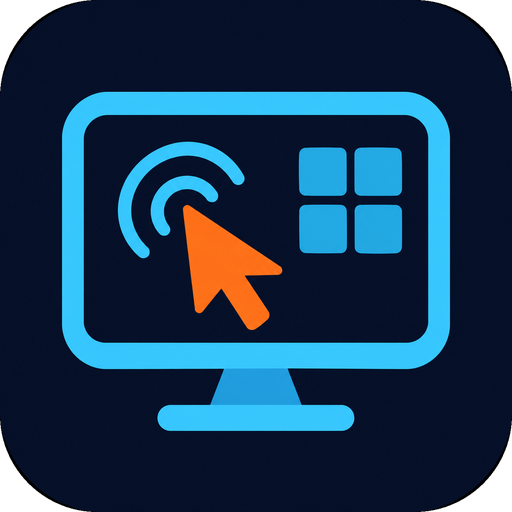
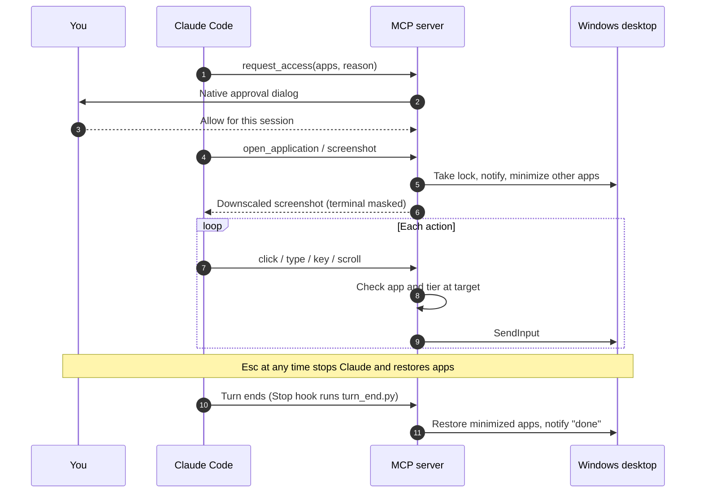

<div align="center">



# Windows Computer Use for Claude Code

**Let Claude see and control your Windows desktop, with the same guardrails as macOS computer use.**

[](#requirements)
[](#install)
[](https://modelcontextprotocol.io)
[](pyproject.toml)
[](LICENSE)

[Install](#install) · [Usage](#usage) · [How it works](#how-it-works) · [Tools](#tools) · [Safety](#safety) · [Troubleshooting](#troubleshooting)

</div>

---

Claude Code's [computer use](https://code.claude.com/docs/en/computer-use) lets Claude open apps,
click, type and take screenshots. In the CLI it only runs on macOS. This project brings it to
Windows as a Claude Code plugin: an MCP server plus a Stop hook, with the same permission model,
app hiding, emergency stop and single-session lock.

> [!IMPORTANT]
> This is an unofficial community project. It is not affiliated with or endorsed by Anthropic or
> Microsoft. It controls your real desktop, so read [Safety](#safety) before you use it.

## Features

- **Per-app approval.** Allow for this session, Always allow, or Deny, in a native dialog.
- **Follows your permission mode.** `bypassPermissions` skips the dialog, `dontAsk` allows only always-allowed apps.
- **Permission tiers.** Browsers and trading platforms are view-only, terminals and IDEs are
  click-only, and every other app gets full control.
- **Risk warnings.** Apps with shell, filesystem or system-settings reach are flagged before you approve.
- **Focus mode.** Other apps are minimized while Claude works and come back when its turn ends.
- **Terminal privacy.** Your Claude Code terminal is blacked out in screenshots and cannot be
  clicked or typed into.
- **Emergency stop.** Press **Esc** anywhere to stop Claude. The key press is consumed, so
  on-screen content cannot use it.
- **Single session.** Only one Claude session can control the computer at a time.
- **Smart screenshots.** Images are downscaled automatically, and `zoom` shows a region at native
  resolution for small text.
- **No setup.** One `/plugin install`. uv installs Python and the dependencies on first run.

## Requirements

| Requirement | Notes |
| :- | :- |
| Windows 10 or 11 | x64 |
| [Claude Code](https://code.claude.com) 2.1.275 or later | CLI, interactive session |
| [uv](https://docs.astral.sh/uv/) | `winget install astral-sh.uv` |

You do not need to install Python yourself. uv downloads a suitable version if none is found.

## Install

### Plugin (recommended)

Run this in Claude Code:

```text
/plugin install windows-computer-use --marketplace orbz22/claude-code-windows-computer-use
```

Or add the marketplace first:

```text
/plugin marketplace add orbz22/claude-code-windows-computer-use
/plugin install windows-computer-use@windows-computer-use
```

Then:

1. Restart Claude Code.
2. Run `/mcp` and check that `windows-computer-use` is connected.
   The first start takes a few seconds while uv builds the environment.

The plugin installs the MCP server and its two hooks (permission mode and turn end). You do not need to edit `settings.json`.

### Manual install

```powershell
git clone https://github.com/orbz22/claude-code-windows-computer-use.git
cd claude-code-windows-computer-use
claude mcp add --scope user windows-computer-use -- uv run --quiet --directory "$PWD" server.py
```

Then add the hooks to `~/.claude/settings.json`. Replace `<repo>` with the full path to your
clone, using forward slashes:

```json
{
  "hooks": {
    "PreToolUse": [
      {
        "matcher": "mcp__.*windows-computer-use.*__request_access",
        "hooks": [
          {
            "type": "command",
            "command": "uv run --quiet --directory \"<repo>\" mode_hook.py",
            "timeout": 30
          }
        ]
      }
    ],
    "Stop": [
      {
        "hooks": [
          {
            "type": "command",
            "command": "uv run --quiet --directory \"<repo>\" turn_end.py",
            "timeout": 30
          }
        ]
      }
    ]
  }
}
```

> [!NOTE]
> Claude Code reserves the server name `computer-use`, so this server is called `windows-computer-use`.

## Usage

Ask Claude for something that needs a GUI:

```text
Open Calculator, compute 12 × 34 and take a screenshot of the result.
```

```text
Launch my Electron app from ./dist, click through the onboarding flow and
screenshot each step. Tell me if anything looks broken.
```

```text
Open Paint, draw a red rectangle in the middle of the canvas and save it to the Desktop as box.png.
```

### Approvals

The first time Claude needs an app, the server decides how to approve it based on the
**permission mode of your Claude Code session**:

| Session mode | What happens |
| :- | :- |
| `default`, `acceptEdits`, `plan`, `auto` | The approval dialog appears |
| `bypassPermissions` | No dialog. Apps are approved automatically and a notification says so |
| `dontAsk` | No dialog. Only apps set to **Always allow** are approved. Others are denied |

The dialog lists each app, its tier and any warning:

```text
┌─ Claude Code — computer use ─────────────────────────────────────┐
│ Claude wants to control these apps:                              │
│  ● Calculator  [calculatorapp.exe]                 full control  │
│  ● VS Code  [code.exe]                               click only  │
│     ⚠  Equivalent to shell access                                │
│                                                                  │
│ 3 other app(s) will be hidden while Claude works.                │
│ Reason: Compute a value and show the result.                     │
│ Press Esc anytime to stop Claude.                                │
│                                                                  │
│      [ Allow for this session ]  [ Always allow ]  [ Deny ]      │
└──────────────────────────────────────────────────────────────────┘
```

| Button | Effect |
| :- | :- |
| **Allow for this session** | Approved until you exit this Claude Code session |
| **Always allow** | Approved now and in every future session, without asking |
| **Deny** | Not approved. Claude is told not to retry |

Always-allowed apps are stored in `%LOCALAPPDATA%\claude-win-computer-uselways_allow.json`.
To revoke them, edit that file or delete it.

To keep the dialog even in `bypassPermissions` and `dontAsk` mode, set this environment
variable before starting Claude Code:

```powershell
setx WINDOWS_COMPUTER_USE_ALWAYS_ASK 1
```

> [!NOTE]
> The session mode reaches the server through a `PreToolUse` hook that the plugin installs.
> For a manual install, add that hook too (see [Manual install](#manual-install)). Without it,
> the dialog always appears.

### When Claude uses it

Computer use is the broadest and slowest way to act, so Claude tries more precise tools first:

1. An MCP server for the service, if you have one
2. Bash, for shell work
3. [Claude in Chrome](https://code.claude.com/docs/en/chrome), for browser work
4. Computer use, for everything else: native apps, emulators and GUI-only tools

## How it works



### Permission tiers

| Tier | Applies to | Allowed |
| :- | :- | :- |
| **View only** | Browsers (Chrome, Edge, Firefox, Brave, Opera, Vivaldi, Arc …) and trading platforms (TradingView, MetaTrader, NinjaTrader, IBKR TWS …) | Screenshots only |
| **Click only** | Terminals and IDEs (Windows Terminal, PowerShell, cmd, VS Code, Cursor, Visual Studio, JetBrains IDEs …) | Clicks, scrolling, hover. No typing or key presses |
| **Full control** | Every other app | Everything |

Extra warnings appear in the dialog for:

| Warning | Applies to |
| :- | :- |
| Equivalent to shell access | Terminals and IDEs |
| Can read or write any file | File Explorer and file managers |
| Can change system settings | Settings, Control Panel, Registry Editor, Task Manager, MMC |

Clicking the desktop or taskbar, and any Windows-key shortcut, requires File Explorer to be approved.

### Screenshots

- The primary monitor is captured. Use `screenshot(display=2)` for others.
- Images are scaled to about 1.22 megapixels, so 1920×1080 becomes 1473×828 and a 4K screen
  about 1473×828 as well. Coordinates you pass to other tools use the screenshot's pixels.
- `zoom(x1, y1, x2, y2)` returns a region at native resolution for reading small text.
- The visible part of your Claude Code terminal is painted over, taking window stacking order into account.

## Tools

| Tool | Parameters | Description |
| :- | :- | :- |
| `request_access` | `apps`, `reason`, `clipboard_read?`, `clipboard_write?` | Ask to control apps for this session |
| `list_apps` | | Apps with open windows and their approval state. Titles are shown only for approved apps |
| `screenshot` | `display?` | Capture the screen |
| `zoom` | `x1`, `y1`, `x2`, `y2` | Native-resolution view of a region |
| `left_click` | `x`, `y`, `modifiers?` | Left click, optionally with `ctrl`, `shift`, `alt` or `win` held |
| `right_click`, `middle_click` | `x`, `y` | Right or middle click |
| `double_click`, `triple_click` | `x`, `y` | Double or triple click |
| `mouse_move` | `x`, `y` | Hover |
| `left_click_drag` | `start_x`, `start_y`, `end_x`, `end_y` | Drag with the left button |
| `scroll` | `x`, `y`, `direction`, `amount?` | Scroll `up`, `down`, `left` or `right` by wheel clicks |
| `type` | `text` | Type Unicode text into the focused window |
| `key` | `keys`, `repeat?` | Key or combo, such as `enter`, `ctrl+s` or `ctrl+a delete` |
| `hold_key` | `keys`, `seconds` | Hold keys for up to 10 s |
| `wait` | `seconds?` | Wait up to 30 s, then take a screenshot |
| `cursor_position` | | Cursor position in screenshot coordinates |
| `open_application` | `app` | Launch or focus an approved app |
| `switch_application` | `app` | Bring an approved app to the front |
| `read_clipboard` | | Read clipboard text (needs `clipboard_read`) |
| `write_clipboard` | `text` | Write clipboard text (needs `clipboard_write`) |

Apps can be named in plain words (`"Calculator"`, `"File Explorer"`, `"VS Code"`) or by
executable (`"blender.exe"`).

## Safety

> [!WARNING]
> Unlike Claude Code's sandboxed Bash tool, computer use runs on your real desktop with access
> to every app you approve. In `bypassPermissions` mode it approves every app Claude asks for
> without a dialog. Tiers, Esc and terminal masking still apply.

- **Approve only what the task needs.** Be careful with terminals, IDEs, File Explorer and Settings.
- **Watch while Claude works.** Press **Esc** to stop immediately. Ctrl+C in the terminal also works.
- **Treat on-screen content as untrusted.** Web pages, emails and documents can contain text that
  tries to steer Claude. The server tells Claude to treat on-screen text as data, not instructions.
- **Apps restore their previous state.** Windows 11 Notepad, for example, reopens your unsaved
  tabs, so typing can land in an existing document. Close or save important work first.
- **Avoid sensitive screens.** Don't leave password managers, banking pages or private chats
  open on approved apps.

Built-in guardrails:

| Guardrail | What it does |
| :- | :- |
| Per-app approval | Claude can only control apps you approved, for this session or always |
| Tier enforcement | The app under every click and the app receiving every keystroke are checked |
| Sentinel warnings | Shell, filesystem and system-settings apps are flagged before approval |
| Terminal exclusion | Your Claude Code terminal is masked in screenshots and cannot be controlled |
| Global Esc | A physical Esc stops Claude from anywhere and is swallowed |
| Lock file | Only one session can control the machine at a time |
| Minimize, not hide | Hidden apps stay on the taskbar, so nothing is lost if the server crashes |

## Troubleshooting

<details>
<summary><b><code>windows-computer-use</code> does not appear in <code>/mcp</code>, or shows as failed</b></summary>

- Check that uv is installed and on your `PATH`: `uv --version`.
- Restart Claude Code after installing the plugin.
- Run the server by hand to see errors:
  `uv run --directory <plugin folder> server.py`
- Computer use needs an interactive session. It is not available with `claude -p`.

</details>

<details>
<summary><b>"Computer use is in use by another Claude session"</b></summary>

Another session holds the lock until it exits. Exit that session. If it crashed, the lock is
cleared automatically the next time a session asks for it.

</details>

<details>
<summary><b>"SendInput blocked" or clicks do nothing in one app</b></summary>

The app runs as administrator. Windows blocks input from normal processes to elevated windows.
Run Claude Code as administrator, or run the app without elevation.

</details>

<details>
<summary><b>The approval dialog does not appear</b></summary>

It is a system-modal, topmost dialog, but focus-stealing rules can sometimes push it behind.
Look for it on the taskbar.

</details>

<details>
<summary><b>The dialog still appears in bypass permissions mode</b></summary>

- Check that the `PreToolUse` hook is installed. The plugin adds it. A manual install needs it in `settings.json`.
- Check that `WINDOWS_COMPUTER_USE_ALWAYS_ASK` is not set.
- The mode is read from the hook that runs just before `request_access`. If the file
  `%LOCALAPPDATA%\claude-win-computer-use\mode-<pid>.json` is missing or older than 2 minutes,
  the dialog is shown.

</details>

<details>
<summary><b>I clicked Always allow by mistake</b></summary>

Edit or delete `%LOCALAPPDATA%\claude-win-computer-uselways_allow.json`. The change applies
to the next `request_access`. Apps already approved in a running session stay approved until it exits.

</details>

<details>
<summary><b>My apps stayed minimized</b></summary>

They are restored when Claude's turn ends (Stop hook), after 90 seconds without actions,
or when the session exits. If you installed manually, check the Stop hook in `settings.json`.
You can always restore them from the taskbar.

</details>

<details>
<summary><b>Text is typed into the wrong place, or the first characters are missing</b></summary>

Some apps need a moment after launch or restore. The server waits for the window to own the
foreground, but slow apps can still drop early input. Ask Claude to take a screenshot before typing.

</details>

## Uninstall

```text
/plugin uninstall windows-computer-use
```

Then delete the state folder `%LOCALAPPDATA%\claude-win-computer-use`, which also removes always-allowed apps.
For a manual install, run `claude mcp remove windows-computer-use -s user` and remove the Stop
hook from `settings.json`.

## Development

```powershell
git clone https://github.com/orbz22/claude-code-windows-computer-use.git
cd claude-code-windows-computer-use
uv sync
claude plugin validate .
```

Try the plugin from your checkout without publishing it:

```powershell
claude --plugin-dir .
```

Tuning constants at the top of `server.py`:

| Constant | Default | Meaning |
| :- | :- | :- |
| `PIXEL_BUDGET` | `1_220_000` | Screenshot size budget in pixels |
| `MAX_EDGE` | `1568` | Longest screenshot edge |
| `IDLE_RESTORE_S` | `90` | Seconds without actions before hidden apps are restored |
| `JPEG_QUALITY` | `88` | Screenshot JPEG quality |

The app tier lists (`VIEW_ONLY`, `CLICK_ONLY`, `FILESYSTEM`, `SYSTEM`) and the name aliases
(`ALIASES`) are in the same file.

> [!CAUTION]
> When testing input, use a throwaway window such as a Tkinter test app, not your real
> documents. Some apps restore unsaved state on launch.

### Project layout

| Path | Role |
| :- | :- |
| `server.py` | MCP server: tools, permission policy, screenshots, turn lifecycle |
| `dialog.py` | Approval dialog (Allow for this session / Always allow / Deny) |
| `mode_hook.py` | PreToolUse hook: records the session's permission mode |
| `winapi.py` | ctypes wrappers: windows, `SendInput`, Esc keyboard hook, clipboard, dialog |
| `common.py` | State shared with the Stop hook: paths, lock, notifications, restore |
| `turn_end.py` | Stop hook: restores hidden apps when Claude's turn ends |
| `.claude-plugin/` | Plugin and marketplace manifests |
| `.mcp.json` | MCP server the plugin registers |
| `hooks/hooks.json` | Stop hook the plugin registers |
| `pyproject.toml`, `uv.lock` | Dependencies, run with uv |
| `assets/` | Logo |

## Contributing

Issues and pull requests are welcome. Good first contributions:

- More apps in the tier lists and aliases
- An optional allowlist or denylist of apps
- Tests with a throwaway GUI target

Please describe how you tested any change that sends input.

## Acknowledgements

Behaviour follows Anthropic's
[computer use documentation](https://code.claude.com/docs/en/computer-use) for Claude Code on macOS.
Built on the [Model Context Protocol Python SDK](https://github.com/modelcontextprotocol/python-sdk),
[mss](https://github.com/BoboTiG/python-mss), [Pillow](https://python-pillow.org) and
[psutil](https://github.com/giampaolo/psutil).

## License

[MIT](LICENSE)
